

# M-Film

**Your Canon, shot like film.**

A film camera's interface for Canon cameras that run Magic Lantern. 
Load a roll from a shelf of 68 film stocks, shoot without looking at the screen, then develop the roll: in the camera, or on your computer with **Darkrooms**. 
The camera side is free and open, for everyone.

**English** · [ภาษาไทย](README.th.md) · [Films](#68-films) · [Cameras](#cameras) · [Darkrooms](#develop-on-your-computer-darkrooms) · [Take it further](PORTING.md)

 

---

## A film camera, inside your camera

M-Film replaces the camera's menus with a film camera drawn from scratch, with Magic Lantern running
underneath. There is no picture on the screen after each shot and no going back through them: you shoot
the roll, then develop it and see what you got.

<table>
<tr>
<td width="50%">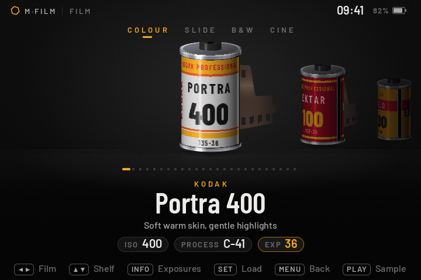</td>
<td width="50%">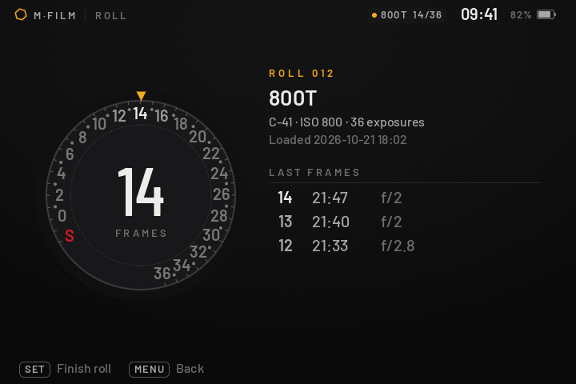</td>
</tr>
<tr>
<td><b>Load a roll.</b> A shelf of canisters that turn to face you. Pick one and the leader comes out of it.</td>
<td><b>Count your frames.</b> A film camera's frame counter, from S to the last frame of the roll.</td>
</tr>
<tr>
<td>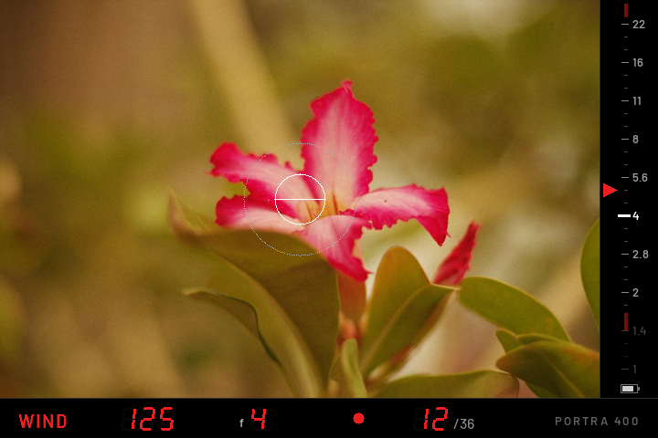</td>
<td>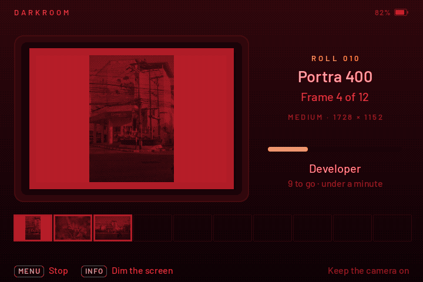</td>
</tr>
<tr>
<td><b>Shoot.</b> An SLR viewfinder over LiveView: aperture scale, light meter needle, red seven-segment frame count. Or one of three quieter ones.</td>
<td><b>Develop in the camera.</b> The darkroom develops the finished roll frame by frame, into JPEG folders on the card, at the size you choose.</td>
</tr>
<tr>
<td>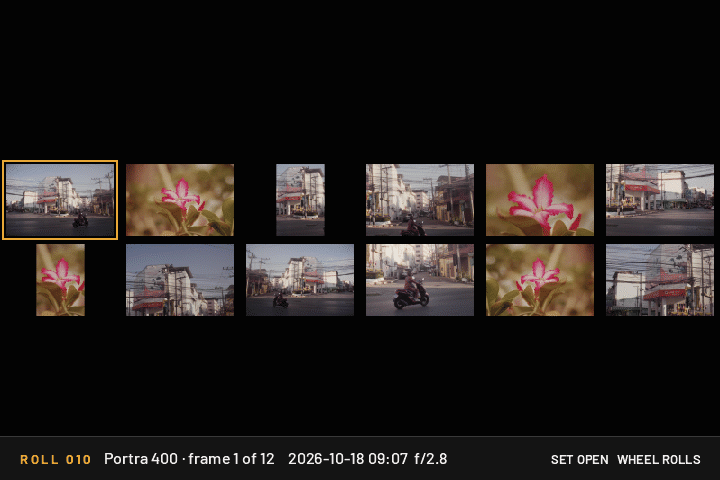</td>
<td>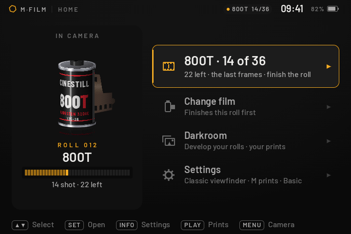</td>
</tr>
<tr>
<td><b>See the prints.</b> A contact sheet of the roll, each print full screen, and closer with the wheel.</td>
<td><b>Home</b> instead of the camera's menu: the roll you have loaded and everything else.</td>
</tr>
</table>

Every RAW is kept, so nothing is lost: you can develop the same roll again with another film later.

**Focusing a manual lens.** Loading a roll sets the camera to the film's ISO, and LiveView shows the exposure
the frame will get: with a slow film, or an adapted lens stopped down, it can be too dark to focus. Turn off
*Settings → Exposure simulation* and LiveView stays bright enough to focus, whatever the exposure.
(Not on the 600D, 1100D and 1300D: Magic Lantern can't set it there.)

### New in 0.2

**0.2.4** gives nine film stocks their colour from [spektrafilm](docs/spektrafilm.md), which builds each film
from its maker's data: Portra 160, 400 and 800, Ektar 100, Gold 200, Kodachrome 64, Pro 400H, Velvia 100 and
Provia 100F. Portra 400 and Pro 400H have finer grain, and the 1300D no longer freezes at power on
([what's new](CHANGELOG.md#024)).

**0.2.3** is about colour, on every camera. A roll comes out the same colour in the camera and in
**Darkrooms**: the two develop the same way and read the same colour tables. Blown highlights are no longer
pink, and every colour film changes, so pictures won't match the ones 0.2.1 developed. The four cinema print
films left the shelf: if one is loaded, rewind it before you update.

**Copy the whole `ML` folder of the zip to the card**, not only `autoexec.bin`: the films' colour tables are
files in `ML/DARKROOM` now, and without them the darkroom stops with "no colour table".

<table>
<tr>
<td width="50%">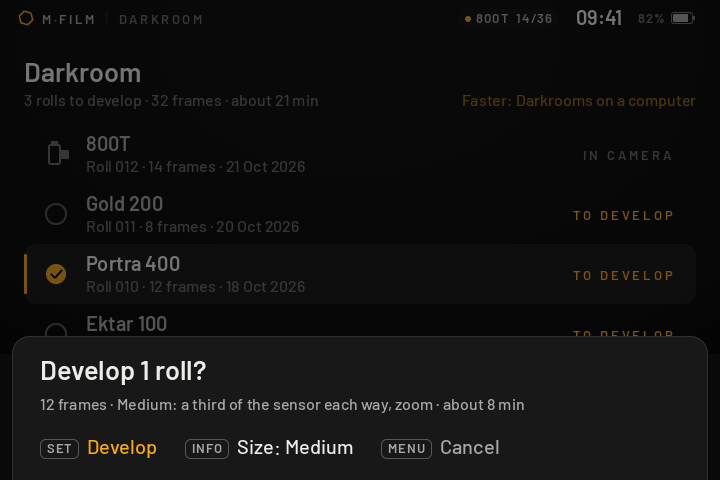</td>
<td width="50%">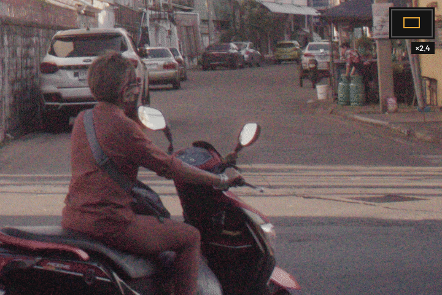</td>
</tr>
<tr>
<td><b>Bigger prints.</b> Small, Medium or Large, asked before the darkroom starts: up to 2592 × 1728 from an 18 MP camera.</td>
<td><b>Zoom.</b> In the prints, turn the wheel to go into a frame and the arrows to move about.</td>
</tr>
<tr>
<td>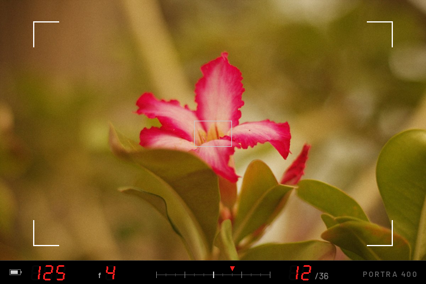</td>
<td></td>
</tr>
<tr>
<td><b>Four viewfinders.</b> Classic (the SLR's), Minimal, Rangefinder and Clean: <i>Settings → Viewfinder</i>.</td>
<td><b>A shorter Home.</b> What to do next on top, then Darkroom and Settings. The battery is on every page.</td>
</tr>
</table>

Also in 0.2: a date stamp, the camera's own white balance, a shelf of the films you loaded last, Settings on
one page, and the film OS as a module on every camera. **Everything, version by version: [CHANGELOG.md](CHANGELOG.md).**

### How big the prints are

The camera's darkroom develops in three sizes. You choose when you start it (*INFO* on the Darkroom page
asks, and remembers) or in *Settings → Print size*:

| | Horizontal frame, from 18 MP | What it is | Zoom in the camera |
|---|---|---|---|
| **Small** | 720 × 480 (0.35 MP) | the camera's screen: the quickest | none |
| **Medium** | 1728 × 1152 (2 MP) | a third of the sensor each way | × 2.4 |
| **Large** | 2592 × 1728 (4.5 MP) | half the sensor each way | × 1.8 and × 3.6 |
| **Darkrooms on a computer** | the full RAW, 5184 × 3456 (18 MP) | every pixel | |

- A vertical frame is the same, turned upright. Other sensors give in proportion: Large is 2736 × 1824 on a 6D,
  2880 × 1920 on a 5D Mark III.
- A bigger print takes longer: by the work it is, about 2.6 times a small one for Medium and 4.4 times for Large
  (on an EOS M with 0.2.3 a small one took 22 to 27 seconds a frame, and a Medium one about 50).
  The Darkroom page says how long before you start, from the frames the camera has developed at that size.
- The JPEG in `DCIM` is the size you chose. Medium and Large prints also keep a file to zoom into on the card
  (2 MB and 4.5 MB a frame).
- A camera without the memory for the size you asked makes the next one down, and says so.
- To make a roll's prints bigger later: *Delete → Prints only* on the Darkroom page, then develop it again.
  Your RAWs stay on the card, so **[Darkrooms](#develop-on-your-computer-darkrooms)** can also develop
  any roll you've shot at full size.

### Basic or Realistic

<table>
<tr>
<td width="50%">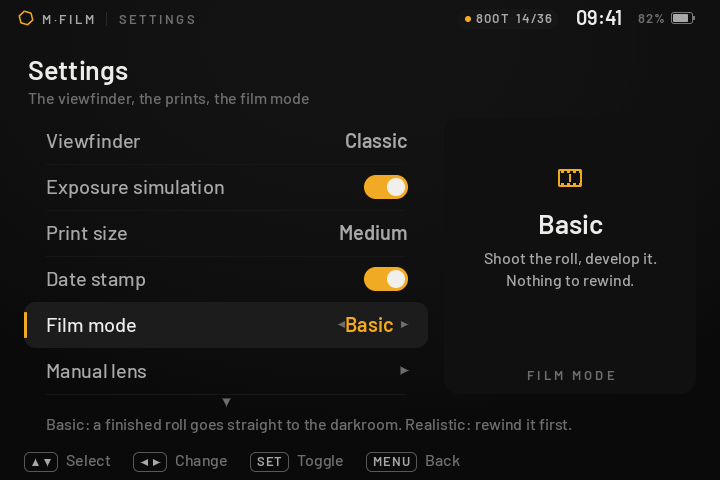</td>
<td width="50%">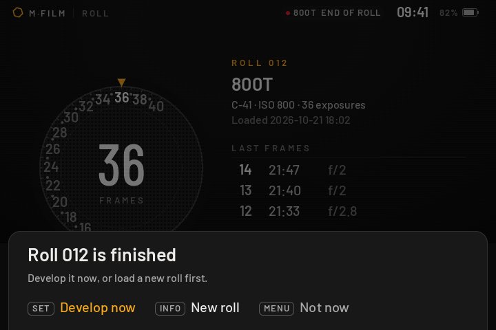</td>
</tr>
<tr>
<td><b>Choose how real.</b> <i>Settings → Film mode</i>.</td>
<td><b>Basic</b> (the default): the last frame finishes the roll, and it goes straight to the darkroom. No rewinding.</td>
</tr>
</table>

- **Basic:** shoot, then develop. Stop early with *Finish roll* on the roll's page (the first row of Home).
- **Realistic:** like a real film camera. Rewind the roll before it can be developed.
- Either way the roll is the same on the card, so Darkrooms reads both.

### On a DSLR: a top plate

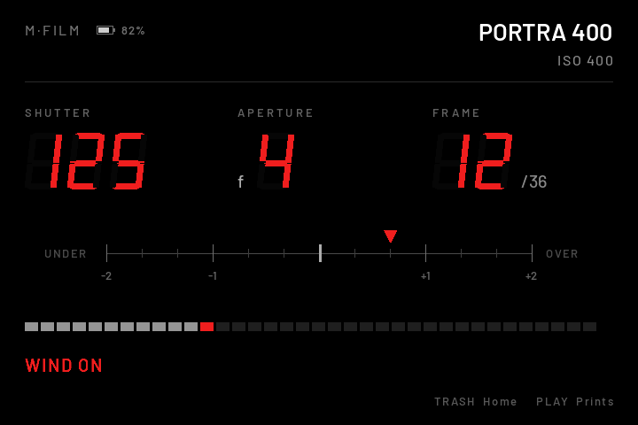

A DSLR shoots through its optical viewfinder, so there is no LiveView to draw on. With a roll loaded and
LiveView off, the back screen becomes a film camera's top plate:

- shutter, aperture and frame in big seven-segment digits
- the film and its ISO
- a light meter from −2 to +2 stops, and a bar of the frames left
- WIND ON when the next frame needs winding

It goes off when you put your eye to the viewfinder, and LiveView brings the viewfinder HUD back.
*New in 0.1.1, still waiting for a DSLR tester: see [Cameras](#cameras).*

---

## 68 films

Colour negative, slide, black and white, and cine film, on four shelves. Each film has its own colour,
grain, halation and softness; rolls come in 36, 24 or 12 frames.

<!-- samples: docs/samples/<film>.jpg (3:2), made by ml-dev/films/pictures.py from ml-dev/films/sample/SAMPLE.CR2 -->
<table>
<tr>
<td width="33%">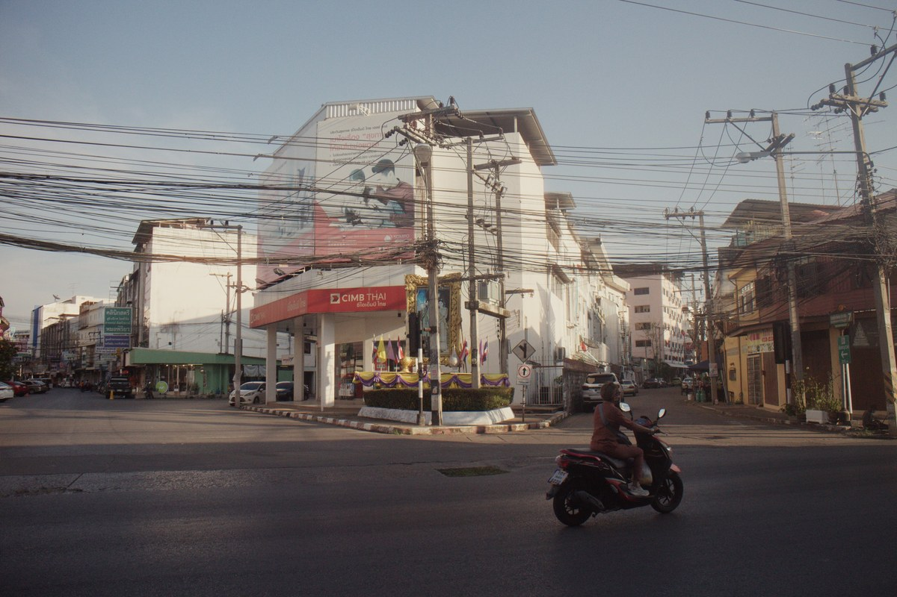 <b>Kodak Portra 400</b> Soft warm skin, gentle highlights</td>
<td width="33%">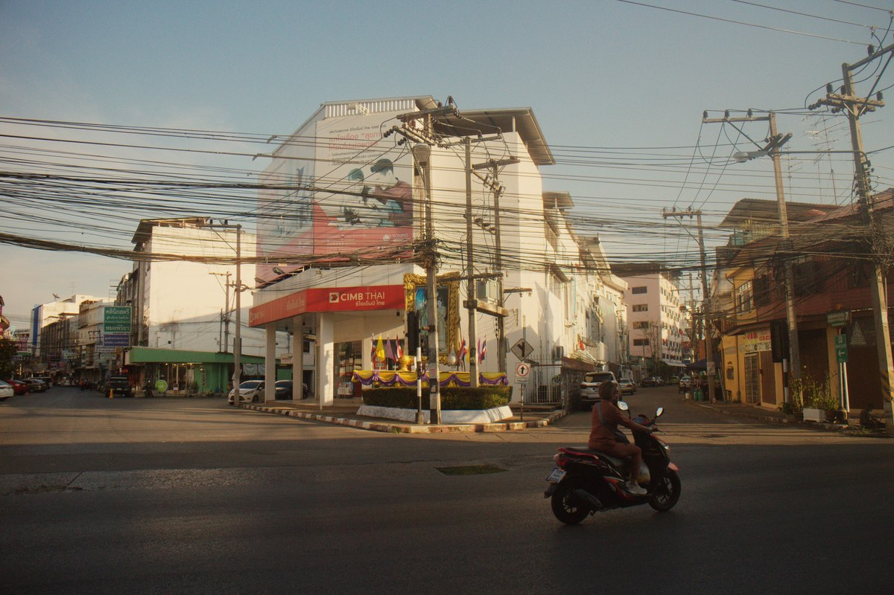 <b>Kodak Gold 200</b> Golden hour, all day long</td>
<td width="33%">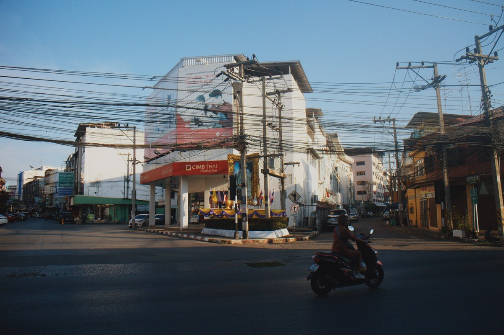 <b>Kodak Ektar 100</b> Punchy colour, ultra fine grain</td>
</tr>
<tr>
<td>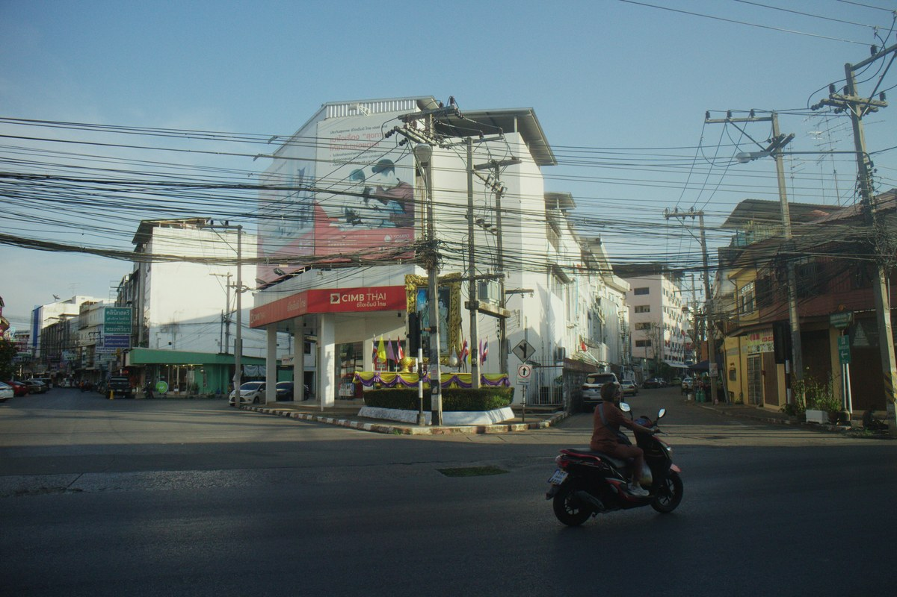 <b>Fujicolor Superia 400</b> Green shadows, everyday snaps</td>
<td>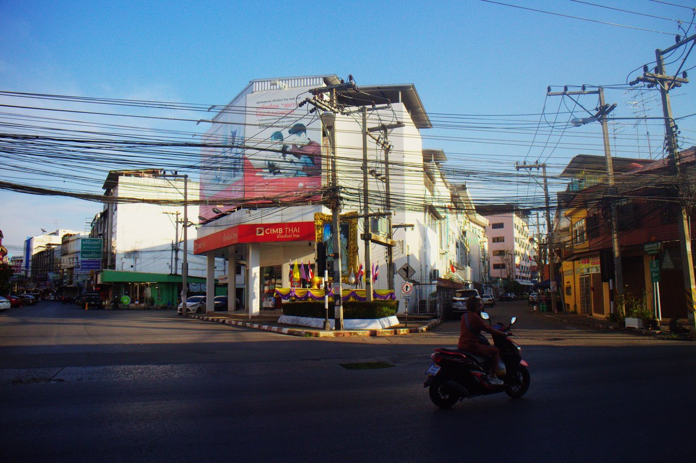 <b>Fujichrome Velvia 50</b> Vivid slide film, hard contrast</td>
<td>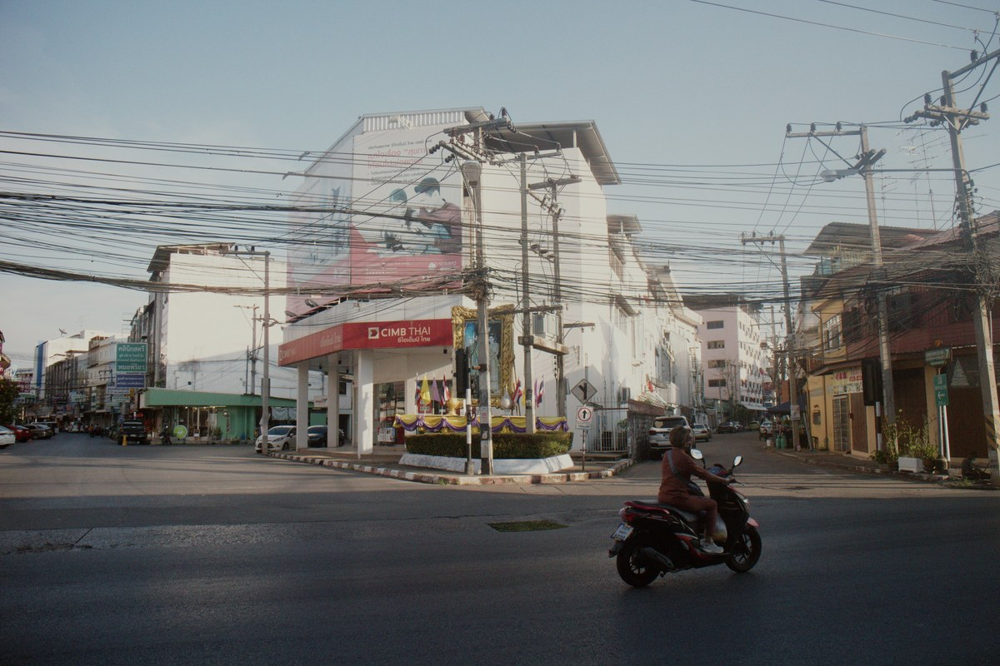 <b>Kodak Kodachrome 64</b> Magazine colour of the 70s</td>
</tr>
<tr>
<td> <b>CineStill 800T</b> Tungsten cine film, night goes blue</td>
<td>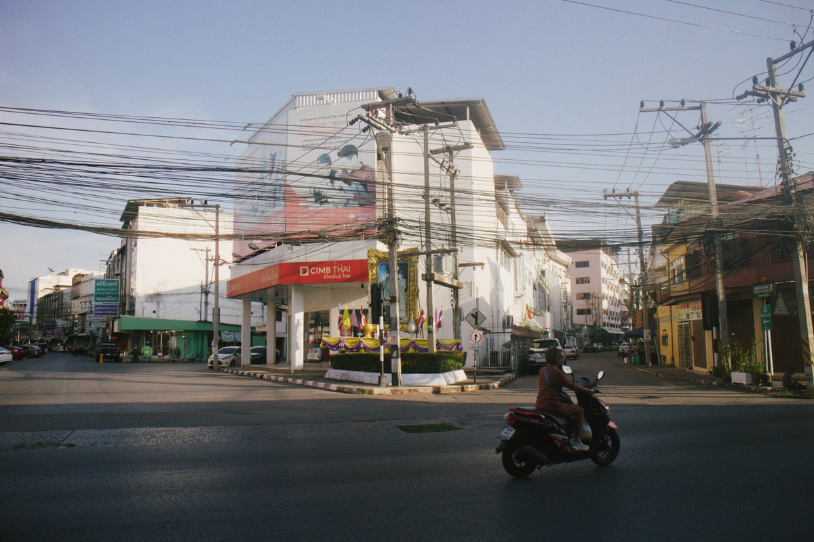 <b>Fujifilm Pro 400H</b> Airy pastels, fourth colour layer</td>
<td>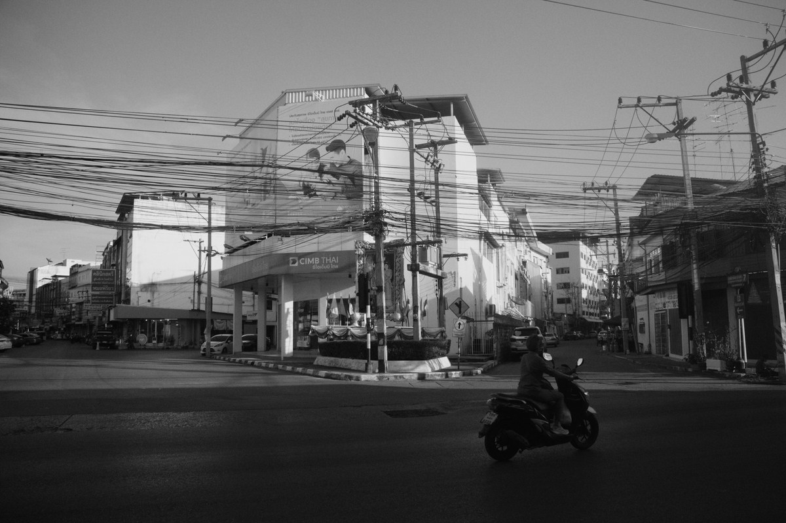 <b>Kodak Tri-X 400</b> Gritty contrast, street classic</td>
</tr>
</table>

**[All 68 films, on the same photo →](FILMS.md)**

<!-- film-states:start -->
**None of the 68 film stocks is measured against the real film yet.** 65 are in the style of their film and not measured yet. 2 (Kodak HIE Infrared, Rollei Infrared 400) are impressions of infrared film: a Canon with its infrared filter in place does not record what that film does. 1 (CineStill 400T) is M-Film's own and stands for no real film. A film stock counts as measured when its colour and tone come within the pass marks of a lab scan of a roll of the real film, shot beside a Canon: [how a film stock becomes measured](docs/paired-shot.md). [Every film stock's state →](FILMS.md)
<!-- film-states:end -->

Colour for 53 of them comes from film emulation tables by [Pat David](https://patdavid.net),
[CC BY-SA 4.0](https://creativecommons.org/licenses/by-sa/4.0/), taken from G'MIC through the [Film-Luts](https://github.com/YahiaAngelo/Film-Luts)
collection: looks made by eye, not measurements of the films ([THIRD_PARTY.md](THIRD_PARTY.md#the-film-colour-tables-cc-by-sa-40)).
For 9 (Portra 160, 400 and 800, Ektar 100, Gold 200, Kodachrome 64, Pro 400H, Velvia 100, Provia 100F) it comes
from [spektrafilm](https://github.com/andreavolpato/spektrafilm) by Andrea Volpato, CC BY-SA 4.0, which builds each film from its maker's data
([how they compare](docs/spektrafilm.md)). The rest come from M-Film's own film models
([`ml-dev/films/films.py`](ml-dev/films/films.py)).

---

## Cameras

M-Film was made on the EOS M, where it works. It now builds for every camera on which Magic Lantern
itself is mature (DIGIC 4 and 5). Testers have tried most of them now: the table says how far each one got, and what's
still wrong. If you have one marked *needs a tester*, you can help: [TESTING.md](TESTING.md) says how (about 20 minutes, and you can always go back).

<!-- cameras:start -->
| Camera | Canon firmware | Status | Notes | Card files |
|---|---|---|---|---|
| Canon EOS M | 2.0.2 | ✅ **Works** | From 0.2 the film OS loads as a module here too (as on the 550D and 650D), and it starts: tried with 0.2.3, rolls shot and developed in the camera. 0.2 can keep Canon's exposure scale off the viewfinder: *Advanced → Hide Canon's graphics* ([#67](../../issues/67)). | `M-Film-<version>-camera-EOSM.202.zip` |
| Canon EOS 5D Mark II | 2.1.2 | ✅ **Works** | Works since 0.1.3, whose smaller build no longer hangs at power on and fixes the pink prints ([#18](../../issues/18), [#32](../../issues/32)); another owner reports no hang either ([#157](../../issues/157)). 0.2 not confirmed here yet: say if it starts. | `M-Film-<version>-camera-5D2.212.zip` |
| Canon EOS 5D Mark III (firmware 1.1.3) | 1.1.3 | ✅ **Works** | Works since 0.1.3: starts and shoots, and the in-camera darkroom finds the RAWs and develops whole rolls ([#31](../../issues/31)). 0.2 not confirmed here yet: say if it starts. | `M-Film-<version>-camera-5D3.113.zip` |
| Canon EOS 5D Mark III (firmware 1.2.3) | 1.2.3 | ✅ **Works** | Works since 0.1.3: starts and shoots ([#16](../../issues/16), [#37](../../issues/37)). The darkroom couldn't find the RAWs before 0.1.3; the fix is the same on both firmwares, and a 5D Mark III developed whole rolls with it ([#31](../../issues/31)). 0.2 not confirmed here yet: say if it starts. | `M-Film-<version>-camera-5D3.123.zip` |
| Canon EOS 6D | 1.1.6 | ✅ **Works** | Works since 0.1.2 ([#17](../../issues/17), [#22](../../issues/22)). From 0.2 the film OS loads as a module here too (as on the 550D and 650D), and it starts: tried with 0.2.1, the film shelf with both dials, and the darkroom's bigger prints ([#17](../../issues/17)). Canon's own screen still shows while a frame is being saved to the card, then M-Film's comes back ([#17](../../issues/17)). 0.2 lights the readout when a dial is turned ([#23](../../issues/23)): say if it still stays dark. | `M-Film-<version>-camera-6D.116.zip` |
| Canon EOS 50D | 1.0.9 | ✅ **Works** | Works ([#43](../../issues/43)). 0.1.5 repaints the plate when Canon draws over it, but a slight flicker may remain, as on the 500D; 0.1.6 puts the plate together off-screen and puts back only what Canon drew over: reports wanted in [#64](../../issues/64). 0.2 not confirmed here yet: say if it starts. | `M-Film-<version>-camera-50D.109.zip` |
| Canon EOS 60D | 1.1.1 | ✅ **Works** | Works since 0.1.3 ([#25](../../issues/25)). 0.1.5: Screen orientation for a broken hinge switch ([#49](../../issues/49)). 0.2 not confirmed here yet: say if it starts. | `M-Film-<version>-camera-60D.111.zip` |
| Canon EOS 70D | 1.1.2 | ⚠️ Tried, known problem | 0.1.5 works on a tester's 70D, with the film OS as a module ([#40](../../issues/40)); on another, Magic Lantern installs but the camera then starts Canon's own firmware ([#58](../../issues/58)): more reports wanted. | `M-Film-<version>-camera-70D.112.zip` |
| Canon EOS 100D / Rebel SL1 / Kiss X7 | 1.0.1 | ✅ **Works** | Works, the film OS as a module since 0.1.5 ([#48](../../issues/48)). 0.1.6 as first released (8 Nov) flickered and took no buttons: fixed in the zips rebuilt on 9 Nov and in 0.2, and its tester says it works again ([#73](../../issues/73)). | `M-Film-<version>-camera-100D.101.zip` |
| Canon EOS 500D / Rebel T1i / Kiss X3 | 1.1.1 | ✅ **Works** | Works ([#44](../../issues/44)). 0.1.5 repaints the plate when Canon draws over it, but a slight flicker remains; 0.1.6 puts the plate together off-screen and puts back only what Canon drew over: does it still flicker? ([#64](../../issues/64)) 0.2 not confirmed here yet: say if it starts. | `M-Film-<version>-camera-500D.111.zip` |
| Canon EOS 550D / Rebel T2i / Kiss X4 | 1.0.9 | ✅ **Works** | Works since 0.1.5, the film OS as a module, darkroom included ([#48](../../issues/48), [#50](../../issues/50)). | `M-Film-<version>-camera-550D.109.zip` |
| Canon EOS 600D / Rebel T3i / Kiss X5 | 1.0.2 | ✅ **Works** | Starts and shoots since 0.1.5, the film OS as a module ([#46](../../issues/46)). On a tester's 600D the in-camera darkroom develops at all three sizes, Large at about a minute a frame, and every viewfinder HUD draws in LiveView ([#153](../../issues/153)). Shoot with Image quality RAW. | `M-Film-<version>-camera-600D.102.zip` |
| Canon EOS 650D / Rebel T4i / Kiss X6i | 1.0.4 | ✅ **Works** | Works with the film OS as a module, darkroom included ([#54](../../issues/54)). From 0.1.3 to 0.1.5 the plain zip came without the darkroom (with it built in, the 650D doesn't start: [#34](../../issues/34)): in 0.1.5, take the `-module.zip`. | `M-Film-<version>-camera-650D.104.zip` |
| Canon EOS 700D / Rebel T5i / Kiss X7i | 1.1.5 | ⚠️ Tried, known problem | 0.1.5's module build works on a tester's 700D, darkroom included ([#19](../../issues/19)), but M-Film's and Canon's menus still glitch over each other; 0.1.6 holds Canon's screen as the film OS opens, and as it closes back to the HUD: reports wanted. From 0.1.3 to 0.1.5 the plain zip came without the darkroom: in 0.1.5, take the `-module.zip`. | `M-Film-<version>-camera-700D.115.zip` |
| Canon EOS 1100D / Rebel T3 / Kiss X50 | 1.0.5 | ✅ **Works** | Works on testers' 1100Ds ([#81](../../issues/81), [#109](../../issues/109)): shooting, the frame count in LiveView (the optical viewfinder has nowhere to show one) and the in-camera darkroom at all three sizes, at about 11, 24 and 37 seconds a frame for Small, Medium and Large. Canon's newest firmware for it is 1.0.6, and M-Film needs 1.0.5: on 1.0.6, go back with Canon's 1.0.5 updater first ([#81](../../issues/81)), or *Firmware ver.* → update can stay on *Loading* ([TESTING.md](TESTING.md#if-firmware-ver--update-stays-on-loading)). | `M-Film-<version>-camera-1100D.105.zip` |
| Canon EOS 1300D / Rebel T6 / Kiss X80 | 1.1.0 | 🧪 Builds, needs a tester | New in 0.2.1, on Magic Lantern's own 1300D port, which is new and experimental. Installed with mlinstall over USB, not a firmware update ([TESTING.md](TESTING.md#canon-eos-1300d)). Loading a roll doesn't set ISO, white balance or picture style here: Magic Lantern can't change Canon's settings on the 1300D yet, so the look comes when the roll is developed. Set the camera's white balance to Daylight yourself (Tungsten for a tungsten film): the darkroom develops with the white balance the camera was on. Canon's firmware 1.1.0 comes in two kinds: if the camera hangs at power on, take the battery out and put the old card back. The first tester's 1300D froze at power on with 0.2.1 and 0.2.3: Magic Lantern's 1300D port asked for a lock it hadn't made yet ([#85](../../issues/85)). Their fix is in 0.2.4: with it the film shelf, rolls in the viewfinder and LiveView, and the in-camera darkroom all worked on their camera. Take 0.2.4 or later and say if it works on yours. | `M-Film-<version>-camera-1300D.110.zip` |
| Canon EOS M2 | 1.0.3 | 🧪 Builds, needs a tester | Firmware 1.0.3 only (do not upgrade to 1.0.4). Built on an EOS M2 camera patch over the pinned Magic Lantern base, with the film OS as a module (`ML/modules/filmos.mo` + 8.3 `EOSM2103.SYM`) and the fixed 592 KB AllocateMemory boot reservation (`boot-d45-am.c`); waiting for confirmation on the CI zip. | `M-Film-<version>-camera-EOSM2.103.zip` |

**Not yet:** 5D Mark IV, 5DS R, 6D Mark II, 7D Mark II, 77D, 80D, 200D, 750D, 850D, M50, R, R5, R6, RP, SX70 HS, SX740 HS (Magic Lantern itself is still experimental on these) · 7D (Magic Lantern's current source doesn't build it) · 800D (Magic Lantern has no port for it yet).
<!-- cameras:end -->

✅ tried on the camera and works · ⚠️ tried, with a problem · 🧪 builds; waiting for someone to try it. From 0.2 the film OS is a module on every camera ([why](ml-dev/MEMORY.md)): one zip a camera. *0.2 not confirmed here yet*: the camera worked up to 0.1.6, with the film OS built in, and nobody has said yet whether 0.2's module starts on it. The card files are in each
[release](../../releases/latest). Up to 0.2.3 a zip's name has no version in it: `M-Film-camera-EOSM.202.zip`. The list lives in [`ml-dev/cameras.txt`](ml-dev/cameras.txt); porting
notes in [PORTING.md](PORTING.md).

### Putting it on the camera

1. The camera needs exactly the Canon firmware in the table (MENU → last settings tab → *Firmware ver.*).
2. Unzip the card files for your camera onto an SD card, put it in the camera and run *Firmware ver.* →
   update once. From then on M-Film starts with the camera from that card.
3. In Canon's menu set **Image quality** to **RAW** (RAW+JPEG works too) and **Image review** to **Off**.
   The darkroom develops the RAWs: a frame shot as JPEG can't be developed.
4. Full steps, and how to go back: [TESTING.md](TESTING.md). Building it yourself:
   `ml-dev/build_fork.sh <camera>`.

### Updating to a new version

Don't unzip a new version over the old one: files left from before can make the camera misbehave.
Start from a clean card instead:

1. **Finish the roll** and develop it, in the camera or with Darkrooms. A new install starts with no roll loaded.
2. **Copy your photos off the card** (the `DCIM` folder), including the developed JPEG folders.
3. **Format the card in the camera** and choose to remove Magic Lantern.
4. **Unzip the new version** onto the card, as on the first install.
5. Put the card in the camera and run *Firmware ver.* → update again, then switch the camera on.

Your settings (film, screen colour, Film mode) go back to their defaults: set them again.

---

## Develop on your computer: Darkrooms

The camera develops its rolls by itself, slowly. **Darkrooms** does it on your computer, fast.
Plug the camera in (or put its card in a reader) and open Darkrooms. It finds the camera, shows every
roll you shot with its film, and develops them at full resolution.

<table>
<tr>
<td width="50%"></td>
<td width="50%"></td>
</tr>
<tr>
<td><b>Your rolls</b>, each with its canister and a strip of its frames. Develop whole rolls or pick single frames.</td>
<td><b>The lights go red.</b> Prints come out of the developer and hang on the line.</td>
</tr>
<tr>
<td></td>
<td></td>
</tr>
<tr>
<td><b>Lights on.</b> Every roll gets a contact sheet and its own folder.</td>
<td><b>Full detail.</b> Every pixel of the RAW, JPEG with 4:4:4 colour, EXIF kept, optional date stamp.</td>
</tr>
</table>

### Free, or Full

| | Free | Darkrooms Full |
|---|---|---|
| Rolls a day | 1, of up to 36 frames (the same roll again that day doesn't count) | as many as you like |
| Every film, full size, EXIF, contact sheets | ✓ | ✓ |
| *Fast*: every core at once | | ✓ |
| Price | free, with a Google account | **US$2.99 a month** or **US$14.99 once** (checkout shows your currency), updates included |

The camera's own darkroom stays free and unlimited. Darkrooms goes with your **Google account**: no key to type in or keep.
Click the badge at the top right → *Sign in with Google*, then *Get it monthly* or *Get it for life*. After you pay,
Darkrooms switches to Full by itself within a few seconds. One Google account works on **two computers** at a time, Free or Full
(sign in on the other one with the same account). Cancel the monthly plan any time in the program
(*Manage the subscription*): it stays on until the end of the month paid for.
[Privacy](https://darkrooms-licence.suphalapruksasathit.workers.dev/privacy): your pictures never leave your computer.

### Download

From **[Darkrooms' own page](https://github.com/HNGSeries/Darkrooms-app/releases/latest)**, its own repository, so its
downloads don't mix with the camera's.

| Your computer | File | How to open it |
|---|---|---|
| **Windows 10 / 11** | `Darkrooms-windows-x64.zip` | Unzip, open the `Darkrooms` folder, run `Darkrooms.exe` (the orange icon: Windows often shows it as just `Darkrooms`, without `.exe`). |
| **Mac with Apple silicon** (M1 and later) | `Darkrooms-macos-apple-silicon.zip` | Unzip, drag `Darkrooms.app` to Applications and open it. |
| **Mac with Intel** | `Darkrooms-macos-intel.zip` | Same. |

About 45 MB for Windows and 30 MB for a Mac.

**The first time it opens.** Darkrooms isn't signed with Microsoft or Apple yet, so your computer asks first.
**Windows:** *More info* → *Run anyway*. **Mac:** *System Settings → Privacy & Security*, scroll down, *Open Anyway*
(macOS 14 and older: right-click the app → *Open*); if it still won't open,
`xattr -dr com.apple.quarantine "/Applications/Darkrooms.app"`. Windows Security has called Darkrooms 0.1.1 a trojan
(`Trojan:Win32/Bearfoos.B!ml`), a guess of its machine-learning model that has been reported to Microsoft as wrong ([#152](../../issues/152)).

**It updates itself.** When a new version is out it says so at the top, shows what's new, and installs it with one
click. Keep it somewhere you can write to (on a Mac, in Applications).

---

## Take it further

- **Have one of the cameras above?** [TESTING.md](TESTING.md): try it and tell us, so it can move to ✅.
- **Another camera?** [PORTING.md](PORTING.md) says what moves easily (the Film OS
  screens), what has to be redone per camera (the Magic Lantern side), and how to go about it.
- **Every screen and button** of the camera side, and how it works inside (in Thai):
  [docs/MANUAL.th.md](docs/MANUAL.th.md).
- **Something broken?** [Open an issue](../../issues/new/choose) and paste what the gear icon →
  *What does the computer see?* shows.
- **The films** (looks, LUT list) are in [`ml-dev/films/`](ml-dev/films/); the camera build bakes them in.
- **Darkrooms**, the desktop program, is closed source and isn't in this repository.

## Support

The camera side of M-Film is free and stays free. If it gave you a roll you like, you can
**[buy the developer a coffee ☕](https://buy.stripe.com/7sY14p8d93QE5Ny5M58so02)**.

New versions and rolls people shoot with it are posted on
[Instagram](https://www.instagram.com/mfilm.official/), [Threads](https://www.threads.com/@mfilm.official)
and [X](https://x.com/mfilm_official).

## License

M-Film is made by **HNGSeries**, on top of [Magic Lantern](https://www.magiclantern.fm/).

This repository: GPL-2.0 ([LICENSE](LICENSE)), as the camera side builds on Magic Lantern.
Darkrooms (the desktop program) is a separate, closed-source program under its own licence. The colour tables of
53 films are adapted from Pat David's, and those of 9 derived from spektrafilm by Andrea Volpato; both are
CC BY-SA 4.0, not GPL-2.0. Those, the fonts and other
parts: [THIRD_PARTY.md](THIRD_PARTY.md). Not affiliated with Canon, Kodak, Fujifilm or any film maker.
