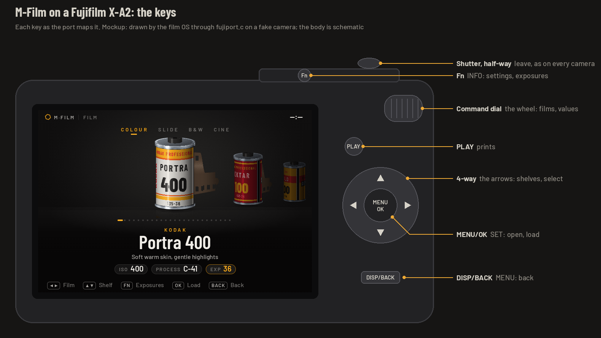

# M-Film on Fujifilm cameras

The film OS on a Fujifilm body, over [FujiHack](https://github.com/fujihack/fujihack) instead of Magic Lantern.
**A scaffold:** it builds, and it runs whole on a fake camera on a PC, but it has never run on a Fujifilm.
Why it is done this way: [ADR 0002](../../docs/adr/0002-fujifilm-port-on-fujihack.md).

> ภาษาไทยสั้นๆ: โครงพอร์ต M-Film ไป Fujifilm ผ่าน FujiHack (ไม่ใช่ Magic Lantern) หน้าจอ Film OS ใช้โค้ดเดิมทั้งหมด
> ส่วนที่เขียนใหม่คือ `fujiport.c` (ตัวเชื่อม `fos_port_*`) กล้องเป้าหมายแรกคือ **X-A2 firmware 1.30** (จอ 720×480 เท่า canvas
> ของ Film OS) ตอนนี้ build ได้ทั้งบน PC และ ARM และรันบนกล้องจำลองได้ แต่ยังไม่เคยรันบนกล้องจริง
> ทุกจุดที่ต้องใช้กล้องจริงตอบมี `TODO(camera)` กำกับไว้ ลำดับงานอยู่ในหัวข้อ "What a camera has to answer" ด้านล่าง



## Where it stands

| Part | State |
|---|---|
| The film OS's screens (`../filmos/`) | Unchanged, but for the keys' names: built with `FOS_KEYS_FUJI`, the hints say OK, BACK and FN |
| `fujiport.c`: time, keys, screen, files, settings | Written from FujiHack's notes; runs on the fake camera |
| Built for the camera (`make camera`) | Compiles for ARM against FujiHack's `model/xa2_130.h`: about 237 KB of objects |
| Linked into an app FujiHack's loader runs | Not yet |
| On a camera | Never |

| Camera | Firmware | Screen | What FujiHack knows |
|---|---|---|---|
| **X-A2** (first) | 1.30 | 720 × 480, the film OS's own size | files, keys, screen layers, timer, tasks |
| XF1 | 1.01 | 640 × 480: the canvas is squeezed to fit, and small text breaks up | the most, and the only one where running code is confirmed; but its screen is `MEM_SCREEN_BUFFER`, not the layers this port paints, so `make camera MODEL=xf1_101` doesn't build yet |
| others | | | too little to start from (see FujiHack's `model/`) |

## Building

```bash
make check          # the port and the whole film OS for a PC, run on a fake X-A2 and XF1
make mockups        # preview/: the screens in a drawing of each camera's back
make camera         # for the camera: needs arm-none-eabi-gcc; fetches FujiHack at a fixed commit
```

`make check` drives the film OS with the keys an X-A2 has (`scenes/check.txt`): Home, the shelf, the
command dial, loading a roll. `checkshots.py` fails it if a screen is the wrong size, blank, or doesn't
change when a key is pressed. `fakefuji.c` stands in for the camera's firmware: it answers only as
FujiHack's notes say the camera does.

## The keys

| X-A2 | The film OS |
|---|---|
| MENU/OK | SET: open, load |
| DISP/BACK | MENU: back |
| The four-way pad | the arrows |
| The command dial | the wheel |
| PLAY | PLAY: the prints |
| Fn | INFO |
| The shutter, half-way | leave, as on every camera |

## What a camera has to answer

In the order a port should go ([PORTING.md](../../PORTING.md), "How to go about a port"). Each is a
`TODO(camera)` in `fujiport.c`.

1. **Getting in.** FujiHack's app loader runs an ELF from the card; FujiHack itself takes over a menu of
   the firmware's (on the X-A2, Instax printing). Link `fujiport.o` and the film OS into an ELF for it
   (`ML/MFILM.ELF`) with `mfilm_main()` as the entry, and see Home appear.
2. **The screen.** Which of the three layers is on show (the port paints all three, as FujiHack does);
   whether alpha 0 lets LiveView show through.
3. **The keys.** What `key_status` says for pressed, held and released, and how the command dial says
   which way it turned.
4. **Memory.** FujiHack's `malloc` goes through SQLite's allocator, about 2 MB in all. The screens fit
   (the canvas is 345 KB); the darkroom, which on a Canon develops in slices of tens of MB, probably
   doesn't. Find more memory, or leave the darkroom to Darkrooms on the computer.
5. **The card.** Listing a folder (`fuji_dir_open`/`next`: one listing at a time, its arguments unknown),
   making and removing folders. Until then the darkroom finds no rolls.
6. **Counting frames.** The firmware's "picture taken" code, to hook (FujiHack has it on the X-T10 only).
7. **Setting the camera to the film.** ISO, white balance, and a film simulation to look through:
   nothing of Fujifilm's settings can be changed yet.
8. **The RAW.** The darkroom reads Canon's CR2; a Fujifilm writes RAF. The X-A2's sensor is Bayer, like
   a Canon's, so the developing carries over; X-Trans bodies (X-T10 and up) would need their own.
9. The clock, the battery, the lens.

## Ground rules

- FujiHack patches the camera's firmware; Magic Lantern doesn't. A bad build may not be undone by taking
  the card out. Know how to put Fujifilm's own firmware back before you try anything on a camera.
- FujiHack is GPL-3.0, M-Film GPL-2.0: what can be given out built is a decision before the first
  release ([ADR 0002](../../docs/adr/0002-fujifilm-port-on-fujihack.md)).
- Never commit Fujifilm firmware.
